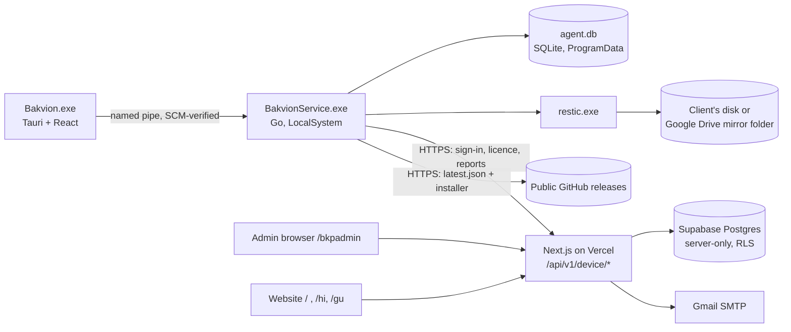

# Architecture

## Desktop app

React screens (Overview, Backup plans, Restore, History, Settings) in Tauri 2. Every action is a JSON request to the service through `\\.\pipe\Bakvion.v1`; the Rust side checks the pipe server is the registered `BakvionService` process. The app holds no keys and no data; closing it never stops backups.

## Service

- **Store:** embedded, versioned SQLite migrations (`internal/core/migrations`, newer schemas refused).
- **Licence:** Ed25519-signed tokens from the server; full mode until the synced expiry, then restore-only; a clock high-water mark resists clock rollback. Refresh every 6 hours.
- **Plans and jobs:** one worker; each destination is a separate job; interrupted runs are marked, never assumed successful.
- **Scheduler:** checks every minute; missed runs collapse into one catch-up run.
- **Keys:** a random key per destination, sealed with DPAPI (machine scope) in the database; the recovery kit exports them.
- **Backups:** restic with VSS (`--use-fs-snapshot`) and a retry without it; exit code 3 counts as a warning; cleanup (`forget --prune`) only after a complete snapshot.
- **Volumes:** each destination remembers its disk's volume ID; a missing path is searched under the current drive letters; free space is measured after each run.
- **Reports:** finished runs go to a local outbox and are sent when online; the server decides what to email.
- **Updates:** signed manifest, verified installer, silent install only when idle.

## Server (apps/web)

Next.js route handlers with a repository layer (`lib/server/repo*.ts`) over Supabase using the secret key. Rate limits live in Postgres. Device API: `sign-in`, `license`, `sign-out`, `reports`. Public: `leads`. Cron: `keepalive` (daily, also report summaries and clean-up). Admin pages check the admin session on every request.

## Data that never leaves the PC

Backup contents, file names, keys and folder paths stay on the PC and the client's storage. The server sees client and PC names, app versions, plan and destination names, run times and states, and error text for email reports.
