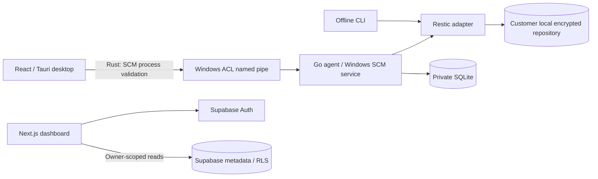

# Architecture and implemented boundaries

There is no agent-cloud connection in this milestone. Device enrollment, signed commands and outbox reconciliation are future work. The database contains an outbox table but no sync worker. The web app cannot scan local drives, run shell commands or request raw filesystem paths.

## Agent

Go owns the restic subprocesses, SQLite and durable queue. One OS file lock admits a single worker per state database. Work is serialized; restic also supplies repository locking. Queued configuration is captured independently for every destination. After worker restart, unconfirmed running work becomes interrupted, not successful or automatically retried. A completed-but-unrecorded restic snapshot can be discovered by listing the repository.

SQLite migrations are embedded and versioned transactionally. Future schemas are rejected. Foreign keys, WAL and busy timeout are enabled on the single database connection. Every destination has a persistent result. Restores have separate persistent history but are currently synchronous; restoring through desktop blocks that request while the service remains alive.

The local protocol is newline-delimited JSON v1, one request per pipe connection. A DACL restricts callers to the configured owner SID, administrators and SYSTEM. go-winio rejects remote pipe clients. The Rust client checks the server PID against SCM's registered BakvionService PID before sending data. No TCP listener exists. Windows behavior is not yet runtime-validated.

## Filesystem and recovery

Only local absolute filesystem paths are accepted in saved plans. Source/repository containment is rejected in either direction, across registered plans and through existing links. Agent state and password files must sit outside sources. Restic does not run through a shell. All inherited RESTIC_* and RCLONE_* environment overrides are removed; the adapter disables shared on-disk cache.

Sources are passed relative to their common parent to avoid archiving unrelated ancestor metadata. Different Windows volumes currently require separate plans. All sources must be present at execution time. A source that disappears during backup may cause a restic nonzero/partial result; it is never treated as confirmed success and no retention follows.

Restore validates full snapshot identifiers and manifest paths, rejects links/special nodes, stages under the target parent, verifies all selected regular files against restic dump content, then publishes a new tree. Existing targets are refused. The output retains the snapshot's directory tree; it is not flattened. Original-path overwrite, preservation of Windows security descriptors and privileged/reparse-point race hardening remain acceptance blockers.

## UI and cloud

Shared UI components use Radix accessible dialog primitives, Tailwind 4 tokens and Lucide icons. The desktop exposes only implemented controls and accurately reports missing service connectivity. Unknown consumption and verification metrics are not fabricated.

The dashboard supports Supabase email OTP sign-in and read-only owner-scoped device/run/snapshot views. RLS defaults to no writes. No service-role key is needed by the deployed app. Application API contracts are currently handwritten Go/TypeScript types; schema generation and compatibility tests remain pending.
